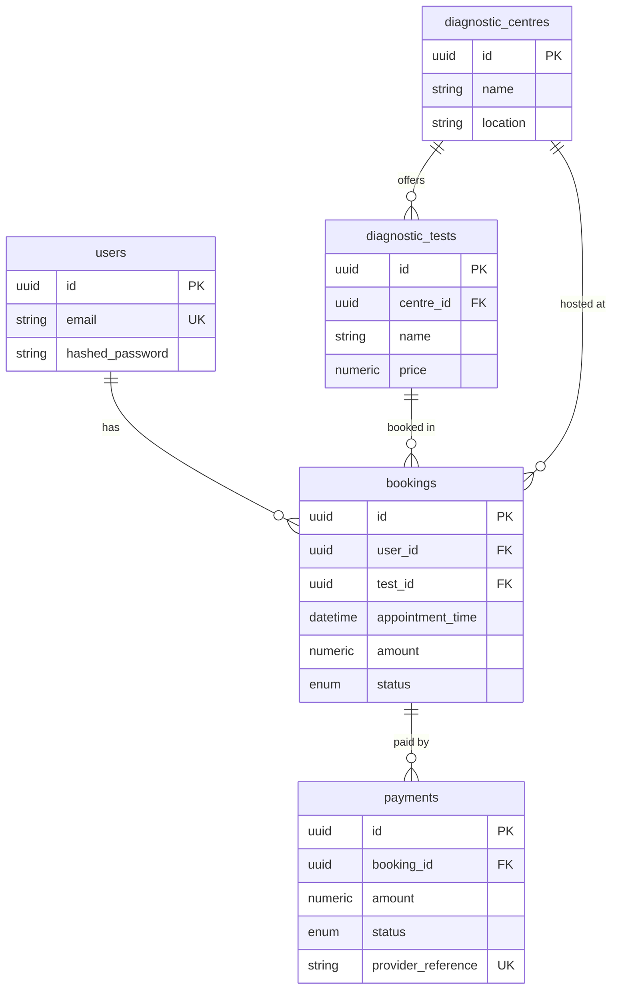

# EVE Diagnostics Booking System

Welcome to the EVE Diagnostics Backend! This is the "engine" behind a healthcare application that allows patients to find diagnostic centres, book medical tests (like blood tests or X-rays), and pay for them securely. 

While this repository contains backend code, this guide is written to be easily understood by anyone—whether you are a recruiter, a product manager, or a software engineer.

---

## 🌟 What does this system do?

Imagine the app from a patient's perspective. This system powers the following features:

1. **User Accounts:** Patients can create an account and log in securely.
2. **Find Clinics & Tests:** Patients can browse different diagnostic centres (clinics) and see what tests they offer and how much they cost.
3. **Book Appointments:** Patients can schedule a medical test for a future date.
4. **Secure Payments:** Patients can pay for their bookings. 
5. **Safety & Reliability (Error Handling):** 
   - You can't book an appointment in the past.
   - You can't view or cancel someone else's booking.
   - **Double-charge protection:** If a payment network glitches and sends a "payment successful" message twice, our system guarantees the patient is only processed once.

---

## 🚀 How to test this yourself (No coding required!)

You don't need to be a developer to see this system in action. The application comes with a built-in, user-friendly graphical interface where you can click buttons to test the features.

### Step 1: Start the application
If you have Docker installed, simply open your terminal in this folder and run:
```bash
docker-compose up --build
```
*(If you are a developer preferring local Python, see the developer section below).*

### Step 2: Open the Dashboard
Open your web browser and go to: **[http://localhost:8000/docs](http://localhost:8000/docs)**
This opens the **Interactive API Dashboard** (Swagger UI). 

### Step 3: Play around!
Try this simple flow to see how the app works:
1. **Create an account:** Scroll down to `POST /auth/signup`, click **"Try it out"**, enter an email and password, and click **Execute**.
2. **Log in:** Go to `POST /auth/login`, click **"Try it out"**, enter the same credentials, and copy the `access_token` it gives you.
3. **Authorize:** Scroll to the very top of the page, click the green **"Authorize"** button, and paste your token. Now the system knows who you are!
4. **See clinics:** Scroll to `GET /centres/`, click **"Try it out"** and **Execute** to see a list of clinics and tests. Copy a test ID (e.g., the ID for a Blood Test).
5. **Book a test:** Go to `POST /bookings/`, paste the test ID, pick a future date, and click **Execute**. You just booked a test!

---

## 🧑‍💻 For Developers & Technical Reviewers

This section covers the architecture, setup instructions, and engineering decisions made to satisfy the assignment requirements.

### Tech Stack
- **Framework:** FastAPI (Python)
- **Database:** PostgreSQL (Production) / SQLite in-memory (Testing)
- **ORM:** SQLAlchemy 2.0
- **Security:** JWT Authentication, bcrypt password hashing, SlowAPI (rate limiting)
- **Testing:** pytest (39 passing tests covering edge cases)

### Running Locally (Without Docker)
```bash
# 1. Create and activate a virtual environment
python -m venv venv
source venv/bin/activate  # On Windows use: .\venv\Scripts\activate

# 2. Install dependencies
pip install -r requirements.txt

# 3. Setup local database config & seed demo data
cp .env.example .env
python scripts/seed.py

# 4. Run the server
uvicorn app.main:app --reload
```

### Database Schema (ER Diagram)



### Engineering Highlights & Edge Cases

1. **Idempotent Webhooks (Double-charge protection):**
   When external payment providers (like Stripe) experience network timeouts, they often retry sending payment success events. To prevent corrupting booking states or creating duplicate payments:
   - We accept a unique `event_id` from the provider.
   - We perform an **atomic database transaction** that simultaneously saves the `event_id`, creates the `Payment` record, and updates the `Booking` status.
   - If a duplicate event arrives, the database's `UNIQUE` constraint instantly rejects it, safely returning an `already_processed` status with zero side-effects.
2. **Financial Data Integrity:**
   `amount` is snapshot-copied onto the `Booking` at creation rather than joining dynamically to the Test's price. If a clinic raises their prices tomorrow, existing bookings maintain the original price. `Numeric(10,2)` is used strictly over `Float` to prevent rounding errors.
3. **Structured Traceability:**
   Every request generates a unique `request_id` tracked via middleware and `contextvars`, outputting structured JSON logs for easy aggregation in tools like Datadog/ELK.

### What I'd Improve With More Time
- **Alembic migrations** instead of `create_all` for proper database version control.
- **Admin Roles (RBAC)** to restrict who can create new clinics and tests.
- **Redis Caching** for the `/centres/` listing endpoints to reduce database load.
- **Background Task Queues (Celery)** for asynchronous webhook processing.
